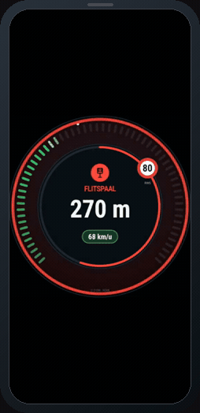
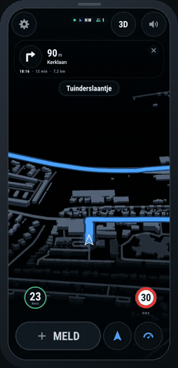
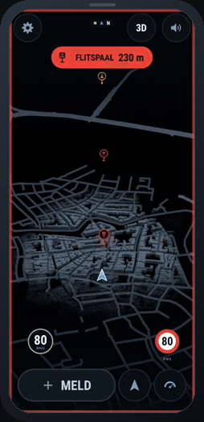
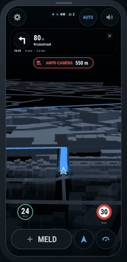
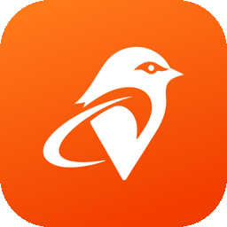
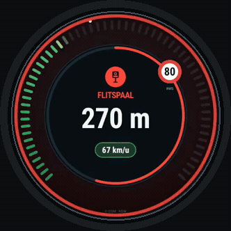
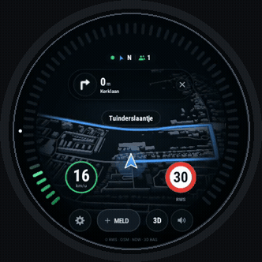
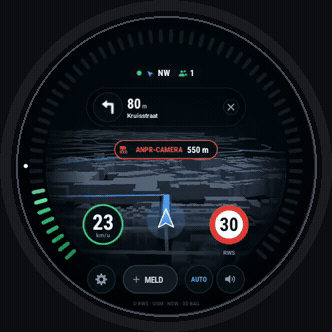

<div align="center">


### Speed, speed cameras, matrix signs and road alerts from official open sources
**No account · No ads · No trip history**

[](https://apps.apple.com/nl/app/pardal/id6836411492)
[](https://discord.gg/HdaQD6NHMN)
[](#independence-trademarks--licence)


-111)


</div>

---

Pardal is a calm co-pilot for the car. It shows your speed and the limit, warns you for speed cameras,
matrix signs and incidents on the road, and lets drivers warn each other — all from official open data,
without an account, without ads and without keeping track of where you drive.

<div align="center">

<table border="0" cellpadding="8">
<tr>
<td align="center"></td>
<td align="center"></td>
<td align="center"></td>
<td align="center"></td>
</tr>
<tr>
<td align="center" width="205"><sub>The meter at the top, and below it everything coming your way on the road.</sub></td>
<td align="center" width="205"><sub>Navigation with spoken directions, arrival time and the road's limit.</sub></td>
<td align="center" width="205"><sub>The map across the whole screen, with a large REPORT button.</sub></td>
<td align="center" width="205"><sub>Navigating between real buildings with their height from 3D BAG.</sub></td>
</tr>
</table>

</div>

## Why Pardal?

Speed-camera and traffic apps have grown ever more crowded, more expensive and more nosy:
subscriptions, accounts, ads and extensive tracking. Pardal is the opposite — a calm
co-pilot that does exactly what is needed and otherwise leaves you in peace.

| | |
|---|---|
| 🟠 **Useful from the very first metre** | The basics come from official open government data, so it is useful right away — even without a large user base. |
| 🟠 **Privacy by design** | No account, no trip history. Shared reports use a rotating, hashed device ID and a position rounded to ~1 km. |
| 🟠 **Calm on screen** | One clear meter, one quiet beep. Nothing that flashes or pops up unless your safety requires it. |
| 🟠 **Open and self-hostable** | The server, the hardware and the boot system are open source. |

## Features

| | |
|---|---|
| **Speed** | Large meter with the applicable limit; a calm warning when you go too fast. |
| **Speed cameras** | Fixed cameras, average-speed (section) controls and ANPR from OpenStreetMap. |
| **Matrix signs** | Live speeds and red crosses (lane closures) from NDW/Rijkswaterstaat. |
| **Road alerts** | Traffic jams, accidents, roadworks, closures and open bridges. |
| **Weather** | KNMI warnings along the way. |
| **Report it yourself** | Police, traffic jam, accident and more — visible to others after three confirmations. |
| **Navigation** | Address search, spoken directions in six languages and automatic re-routing. |
| **Offline map** | 2D/3D map from the Rijkswaterstaat road dataset; no data usage on the road. |
| **Multilingual** | Nederlands, English, Deutsch, Español, Português and Frysk. Light/dark theme. |

Full description: **[docs/FUNCTIES.md](docs/FUNCTIES.md)**.

## Where does it run?

| Platform | Status | |
|---|---|---|
| **iPhone** | ✅ Available, including **CarPlay** | [**Download on the App Store →**](https://apps.apple.com/nl/app/pardal/id6836411492) |
| **Android** | 🚧 On the way | Coming to Google Play |
| **Dedicated car display** | 🚧 Open hardware in development | See [`hardware/`](hardware) and [the end of this page](#running-pardal-on-a-dash01) |

> The Pardal **apps** (iOS, Android) are proprietary and not part of this repository. This repository
> contains the open **server**, **hardware** and **DASH boot system**.

## Privacy

- No account, no ads, no analytics from third parties.
- Your location stays on your device. Only when you share a report does a position go to the server,
  rounded to ~1 km and kept in memory only.
- Device IDs are random and stored hashed; a report becomes visible to others only after three
  independent confirmations.

Details: [privacy statement](docs/play/privacyverklaring.md).

## Data sources

Rijkswaterstaat (WKD, matrix signs), NDW (traffic alerts), KNMI (weather) and OpenStreetMap
(speed cameras, roads) — supplemented with open data from several European countries. Details in
[docs/FUNCTIES.md](docs/FUNCTIES.md#data-sources).

## Self-hosting the server

Shared reports, the live map and navigation run through a small, open backend:

```sh
cd server
docker compose up -d --build
```

Configuration and optional receivers: [server/README.md](server/README.md).

## Open hardware

We are designing a round, standalone car display — a "phone without a camera" for the dashboard — with a
bootloader you can **always unlock and recover**. Open KiCad design and a complete bill of materials:
see [`hardware/`](hardware).

## Repository structure

| Folder | Contents |
|---|---|
| [`server/`](server) | Self-hostable backend (FastAPI + SQLite): shared reports, live map, navigation, app configuration. |
| [`hardware/`](hardware) | Open hardware for a round car display: KiCad PCB and bill of materials. |
| [`dash-pure/`](dash-pure) | Boot system and installer for running Pardal on a DASH01. |
| [`docs/`](docs) | Features, server configuration, installation guide and screenshots. |

## Community



Want to think along, help build, or just ride along and report what went wrong? You are welcome.

- 💬 **[Discord](https://discord.gg/HdaQD6NHMN)** — chat, help and ride-alongs
- 🐛 **[GitHub Issues](../../issues)** and **[Discussions](../../discussions)** — questions, ideas, bugs
- 🤝 **[CONTRIBUTING.md](CONTRIBUTING.md)** · **[ROADMAP.md](ROADMAP.md)** — `good first issue` is a nice place to start

---

## Running Pardal on a DASH01

<div align="center">
<table border="0" cellpadding="8">
<tr>
<td align="center"></td>
<td align="center"></td>
<td align="center"></td>
</tr>
</table>
</div>

The Flitsmeister DASH01 is designed to be used with a Flitsmeister subscription. With a small custom boot system and Android 13, your own hardware can run as a standalone on-board computer: **ignition on → Pardal logo → Pardal**, with no detours.

### Connectivity (4G, Wi-Fi & Bluetooth)

Pardal uses standard Android networking for live traffic alerts and map updates. The installer does not touch the built-in eSIM chip. Without an active Flitsmeister subscription, the built-in eSIM profile still shows the network operator but no longer provides mobile data. To get online, choose one of these:

* **Your own data eSIM:** add a data eSIM profile from a provider of your choice.
* **Wi-Fi hotspot:** connect the DASH01 to your phone's personal hotspot.
* **Bluetooth tethering:** share your phone's internet connection over Bluetooth.

Without a connection, Pardal keeps working with the most recently downloaded maps and speed cameras. As soon as it is online again (eSIM, Wi-Fi or Bluetooth), it updates to the latest speed cameras, road alerts and shared reports.

### Your device, your backup

The installer **first makes a complete, verified backup** of your own device and can
restore it to the factory state. **No factory firmware or Flitsmeister software is distributed**
— the installer uses only what is already on your own device, and the Android image (LineageOS GSI)
is downloaded by you from its official source.

→ [Installation guide](docs/DASH01-INSTALLEREN.md) · [How installation works](docs/BOOTLOADER.md) · [`dash-pure/`](dash-pure)

## Independence, trademarks & licence

Pardal is an **independent project**. It is not affiliated with, endorsed by or sponsored by
Flitsmeister or any other company. "Flitsmeister" and "DASH01" are names/trademarks of their
respective owners and are used here only to describe which hardware Pardal can run on.

This repository contains **no** code, firmware, data, APIs or other materials from Flitsmeister.
Installing Pardal on a device you own is your own choice and at your own risk: it can void your
warranty, and the original software and services will not work while Pardal is installed.
The software is provided **without any warranty**, as described in the licence.

### Licences

| Part | Licence |
|---|---|
| [`server/`](server) | [GNU AGPLv3](server/LICENSE) — if you run a modified version as a public service, you must share its source code. |
| [`hardware/`](hardware) | [CERN-OHL-S-2.0](hardware/LICENSE) — modified designs you make or distribute must be published under the same licence. |
| Everything else ([`dash-pure/`](dash-pure), [`docs/`](docs), ...) | [GNU GPLv3](LICENSE) |

Third-party components keep their own licences (see e.g. [`server/app/static/vendor/LICENSES.txt`](server/app/static/vendor/LICENSES.txt)).

The **Pardal name and logo** are not covered by these licences. You may not use them for your own
version or product without permission.
